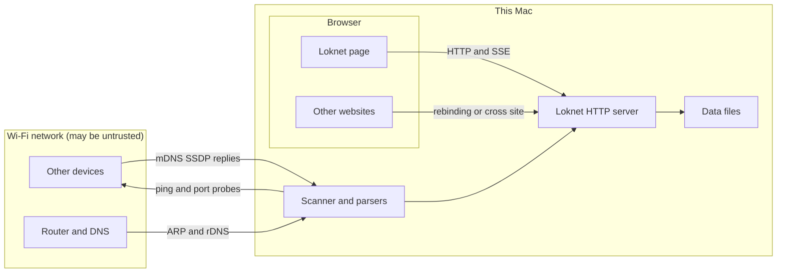

# Loknet threat model

## Executive summary
Loknet is a single-user local Node.js app that scans the LAN this Mac is joined to and serves a dashboard on `127.0.0.1:3000`. It has no npm dependencies, no secrets, and shells out only via `execFile`.

There are two top risk themes:
1. **Browser-borne attacks on the localhost API.** DNS rebinding and cross-site requests let any website the user visits read the device inventory or rename devices, because there is no Host-header allow-list. The Origin check trusts the Host header.
2. **Hostile devices on untrusted Wi-Fi.** The user runs Loknet on public networks. Any device there can feed crafted mDNS/SSDP/rDNS data into Loknet's parsers and SSDP fetcher. In addition, Loknet's own active port probing of strangers' devices is a safety/abuse concern on networks the user doesn't own.

Local file exposure is low risk (single-user Mac).

## Scope and assumptions
- **In scope (runtime):** `server.js`, `scanner.js`, `mdns.js`, `ssdp.js`, `probes.js`, `speed.js`, `vendor.js`, `classify.js`, `known.js`, `history.js`, `public/index.html`, `data/`.
- **Out of scope:**
  - `scripts/fetch-oui.js`: setup tool. It fetches the IEEE CSV over HTTPS, `scripts/fetch-oui.js:5`.
  - Tests and preview stubs.
  - The macOS tools themselves (`ping`, `arp`, `route`, `netstat`, `scutil`).
- **Validated assumptions** (user answers, 2026-11-15):
  - Used on home Wi-Fi **and public Wi-Fi** (café, hotel, school, work).
  - Viewed **only on this Mac**. No remote access is planned, so there's no authn/authz layer.
  - Mac is **single-user**.
- **Open questions that would change ranking:**
  - Will Loknet ever bind to `0.0.0.0` (e.g., to view from a phone)? That would make every API threat remote and require auth.
  - Is it run under a managed/MDM Mac with corporate policy on network scanning? This affects TM-005 severity.

## System model
### Primary components
- **HTTP/SSE server.** Routes are `GET /`, `/api/scan`, `/api/types`, `/api/events` (SSE), and `POST /api/name`. It binds `127.0.0.1` (`server.js:12`, `server.listen(PORT, HOST)` at `server.js:123`). A background scan runs every 30 s (`server.js:133`).
- **Scanner** (`scanner.js`):
  - Runs `route`, `ping`, `arp` and `scutil` via `execFile` (`scanner.js:11`, `:28`, `:62`, `:87`, `:103`).
  - Runs mDNS discovery (`mdns.js`, UDP sockets on an ephemeral port at `mdns.js:100,135`).
  - Runs SSDP M-SEARCH and fetches the description XML (`ssdp.js:22,41`).
  - Runs TCP connect probes to 19 ports and reverse DNS (`probes.js:6,27,58`).
- **Classifier:** `classify.js`, a rules-only classifier of the gathered clues.
- **State:** `known.js` and `history.js`, atomic JSON writes to `data/known.json` and `data/history.json`.
- **Speed monitor:** `speed.js:8`, runs `netstat -ibn -I <iface>`.
- **Browser UI:** `public/index.html`, a single page with an inline script. It renders device data via `esc()` or `textContent`.

### Data flows and trust boundaries
- **LAN devices → Loknet scanner** (UDP mDNS 5353, SSDP 1900 replies, TCP connect results, ARP table, rDNS via LAN resolver)
  - **Data:** names, service lists, TXT records, LOCATION URLs, UPnP XML, PTR names.
  - **Guarantees:** none. The sender is unauthenticated, and UDP source IPs can be spoofed on the LAN.
  - **Validation:**
    - mDNS name parser has a 128-step loop guard (`mdns.js:41`) and a per-packet try/catch (`mdns.js:104`).
    - SSDP LOCATION must be http(s) and its host must equal the responder IP (`ssdp.js:21`).
    - The XML body is sliced to 200 KB *after* the full read (`ssdp.js:23`).
    - No length caps on names.
- **Loknet → LAN devices** (ICMP ping to every address in the /24, TCP connects to 19 ports, HTTP GET of UPnP XML)
  - **Data:** probe traffic.
  - **Guarantees:** the subnet is capped at /24. There is no notion of trusted vs. untrusted network.
- **Browser (any tab/site) → Loknet HTTP server** (HTTP on loopback)
  - **Data:** the device inventory (MACs, IPs, names), rename requests, scan triggers.
  - **Guarantees:**
    - Loopback bind only.
    - `POST /api/name` requires JSON content-type and `Origin == http://<Host>` (`server.js:72`), with a 2 KB body cap and a 40-char sanitized name.
    - **No Host allow-list, no Sec-Fetch checks, no security headers or CSP, no SSE connection cap.**
- **Loknet → local disk** (`data/*.json`, files)
  - **Data:** device inventory, user-chosen names, join/leave history.
  - **Guarantees:** atomic tmp+rename writes. Default umask, so `data/` is 755 and the files are 644.

#### Diagram

## Assets and security objectives
| Asset | Why it matters | Security objective (C/I/A) |
|---|---|---|
| Device inventory (IPs, MACs, types, user names) | Reveals what is in the user's home or who is nearby. It can be used to fingerprint or track the user's devices. | C |
| User-assigned names & history log | Personal labels ("Mar's iPhone") and presence timeline (when devices come and go) | C, I |
| Integrity of alerts | A forged or suppressed "new device" alert defeats Loknet's purpose | I |
| Loknet process & Mac resources | Parsers handle hostile input. A crash or memory blow-up stops monitoring. | A |
| User's standing on networks they don't own | Port-probing strangers' devices on public Wi-Fi can trigger IDS, bans, or policy violations | Safety / A |

## Attacker model
### Capabilities
- **Malicious website** visited in the user's browser while Loknet runs. It can run JS, make cross-origin requests to `127.0.0.1:3000`, and control its own DNS for rebinding.
- **Hostile device on the same Wi-Fi** (realistic on public networks). It can:
  - send arbitrary mDNS/SSDP replies, including with spoofed LAN source IPs
  - serve arbitrary HTTP at its own IP
  - choose its own hostname/PTR records (if it controls DHCP/DNS, e.g. a rogue AP)
  - open or close ports to influence classification
- **Rogue access point / evil-twin router.** It controls ARP, DNS and gateway identity.

### Non-capabilities
- No remote network access to the server, which only binds loopback (`server.js:12`).
- No shell injection through scanned data. All subprocesses use `execFile` with fixed argument arrays, and scanned data never reaches argv except the interface name from `route` output.
- No secrets or credentials to steal. Loknet stores none.
- Other local users: none (single-user Mac).

## Entry points and attack surfaces
| Surface | How reached | Trust boundary | Notes | Evidence (repo path / symbol) |
|---|---|---|---|---|
| `GET /api/scan` | Any browser tab or a rebinding page | Browser → server | Triggers ping sweep + probes; returns full inventory | `server.js` route `/api/scan` |
| `GET /api/events` (SSE) | Same | Browser → server | Streams inventory + history; no connection cap | `server.js` `clients` Set |
| `POST /api/name` | Same | Browser → server | Origin compared to Host header (rebinding-bypassable) | `server.js:72` |
| `GET /` page | Same | Browser → server | Inline script, no CSP or frame protection | `server.js` `/` route |
| mDNS reply parser | UDP to the ephemeral socket during the scan | LAN → scanner | Binary DNS parsing of attacker bytes | `mdns.js` `readName`, `parsePacket` |
| SSDP reply + XML fetch | UDP reply → HTTP GET to LOCATION | LAN → scanner → LAN | Spoofed source IP lets an attacker choose the fetch target; body fully buffered | `ssdp.js` `describe` |
| rDNS / hostnames | LAN resolver PTR answers | LAN → scanner → UI | Unbounded length, shown in UI tooltip | `probes.js` `reverseLookup` |
| Outbound probes | Every scan | Scanner → LAN | 19 TCP ports × every host, every 30 s | `probes.js` `PORTS`, `scanPorts` |

## Top abuse paths
1. **Steal inventory via DNS rebinding:** victim visits `evil.com` → its DNS later resolves to 127.0.0.1 → page JS fetches `http://evil.com:3000/api/scan` (same-origin from the browser's view) → reads every device's IP, MAC and the user's own names and history → exfiltrates.
2. **Tamper names via rebinding:** same setup → `POST /api/name` with `Origin: http://evil.com:3000` and `Host: evil.com:3000` passes the equality check → renames "Unknown intruder" to "Mar's iPhone", hiding a device.
3. **Force scans cross-site:** any page fires `` in a loop → repeated ping sweeps + port probes from the user's Mac → network noise, possible IDS alerts on someone else's network.
4. **SSDP-steered request (SSRF-lite):** a hostile LAN device sends M-SEARCH replies spoofing the router's IP with `LOCATION: http://<router>/<path>` → Loknet issues a GET to that router path from the user's Mac. The fetched `friendlyName`/`modelName` is shown back in the UI.
5. **Parser/memory DoS:** a hostile device answers SSDP with a LOCATION on itself and streams an endless body within 1.5 s → `res.text()` buffers it all → memory spike. Or it floods thousands of spoofed SSDP/mDNS responders → unbounded `found` Map and parallel fetches.
6. **UI injection attempt:** a rogue AP hands out a PTR or mDNS name containing HTML → it's escaped today (`esc()`), but there is no CSP backstop, and unbounded length can break layout.
7. **Unwanted probing on public Wi-Fi:** the user opens Loknet in a café → it port-scans every customer's device every 30 s and stores them in `known.json` / history → network policy violation, possible ban, privacy harm to strangers.

## Threat model table
| Threat ID | Threat source | Prerequisites | Threat action | Impact | Impacted assets | Existing controls (evidence) | Gaps | Recommended mitigations | Detection ideas | Likelihood | Impact severity | Priority |
|---|---|---|---|---|---|---|---|---|---|---|---|---|
| TM-001 | Malicious website | User visits the site while Loknet runs | DNS rebinding to read `/api/scan` and `/api/events` | Full inventory + names + history exfiltrated | Inventory, names, history | Loopback bind (`server.js:12`) | No Host allow-list | Reject Host not in {`localhost:PORT`, `127.0.0.1:PORT`} with 421 | Log rejected Host values | medium | high | high |
| TM-002 | Malicious website | Same as TM-001 | Rebinding + forged rename | Alert integrity: an intruder is disguised | Names, alert integrity | JSON content-type + Origin==Host (`server.js:72`) | Origin compared to attacker-controlled Host | Compare Origin to fixed allow-list; rate-limit renames | Log renames | medium | medium | high |
| TM-003 | Malicious website | User visits a site | Cross-site GET forcing scans; SSE flood | Network noise, resource use | Process resources, user standing | One scan at a time (`server.js` `running`) | No Sec-Fetch checks, no SSE cap | Reject `Sec-Fetch-Site: cross-site/same-site` on `/api/*`; cap SSE at 20; request timeouts | Count rejected requests | medium | low | medium |
| TM-004 | Hostile LAN device | Same Wi-Fi (public networks) | Spoofed SSDP replies steer GETs; endless XML body; responder flood | SSRF-lite GET to LAN hosts; memory DoS | Process, user standing | Host==responder IP, http(s) only, 1.5 s timeout (`ssdp.js:21-22`) | Redirects followed; full body buffered; no responder cap; spoofed IP accepted | `redirect:'manual'`; stream-read cap 200 KB; only describe IPs inside the subnet that also appear in ARP; cap responders at 64 | Log oversize or redirect | medium | medium | high |
| TM-005 | User's own scanning on untrusted networks | Loknet open on public Wi-Fi | Active port probes of strangers; their devices stored | Policy violation or ban; privacy of others | User standing, inventory | /24 cap (`scanner.js` `getNetworkInfo`) | No trusted-network concept | Trusted-network list keyed by gateway MAC; passive mode (no probes, no alerts, nothing saved) until the user trusts the network | Show "passive" badge | high | medium | high |
| TM-006 | Hostile LAN device / rogue AP | Same Wi-Fi | Crafted mDNS/PTR names (HTML, huge strings) | UI break, CSP-less injection risk if an escape is ever missed | UI integrity | `esc()`/`textContent` everywhere (`public/index.html`); mDNS loop guard + try/catch (`mdns.js:41,104`) | No length caps; no CSP | Cap clue strings at 64 chars in scanner; nonce-based CSP; `nosniff`, `frame-ancestors 'none'` | CSP violation reports in console | low | medium | medium |
| TM-007 | Malicious website | User visits the site | Clickjacking the dashboard in an iframe to trigger renames | Name tampering | Names | None | No frame protection | `X-Frame-Options: DENY` + CSP `frame-ancestors 'none'` | none | low | low | low |
| TM-008 | Local process / backup tools | Access to the user's files | Read `data/*.json` | Inventory disclosure | Inventory, names, history | Single-user Mac | 644/755 modes | `data/` 0700, files 0600 | none | low | low | low |

## Criticality calibration
- **critical:** remote code execution in Loknet from LAN data, or anything that exposes the server beyond loopback. Examples: a parser bug giving code exec; an accidental `0.0.0.0` bind with no auth.
- **high:** a website or LAN attacker reading the user's inventory or history, silently falsifying alerts, or making Loknet act as an attack tool. Examples: TM-001 rebinding exfiltration, TM-002 forged rename, TM-005 probing strangers on public Wi-Fi.
- **medium:** resource exhaustion or noisy misuse that needs the user to be on a hostile network or site. Examples: TM-003 forced scans, TM-006 oversized names breaking UI.
- **low:** issues needing local access or unlikely chains. Examples: TM-007 clickjacking renames, TM-008 file modes on a single-user Mac.

## Focus paths for security review
| Path | Why it matters | Related Threat IDs |
|---|---|---|
| `server.js` | All browser-facing entry points, Origin/Host handling, headers, SSE | TM-001, TM-002, TM-003, TM-007 |
| `ssdp.js` | Fetches attacker-chosen URLs and parses attacker XML | TM-004 |
| `mdns.js` | Binary parsing of attacker packets | TM-004, TM-006 |
| `probes.js` | Outbound probing and PTR names | TM-005, TM-006 |
| `scanner.js` | Orchestrates scans; where passive mode and string caps belong | TM-005, TM-006 |
| `known.js`, `history.js` | Persisted inventory; file modes; per-network separation | TM-005, TM-008 |
| `public/index.html` | Rendering of untrusted strings; CSP compatibility | TM-006, TM-007 |

## Quality check
- [x] All discovered entry points are covered: 5 HTTP routes, 2 UDP parsers, the SSDP fetch, rDNS, outbound probes.
- [x] Each trust boundary appears in at least one threat: Browser→server (TM-001/2/3/7), LAN→scanner (TM-004/6), scanner→LAN (TM-005), server→disk (TM-008).
- [x] Runtime vs. setup separated: `scripts/fetch-oui.js` is out of scope.
- [x] User clarifications are reflected: public Wi-Fi raised TM-004/005/006, local-only access keeps auth out of scope, and single-user lowered TM-008.
- [x] Assumptions and open questions are stated.
